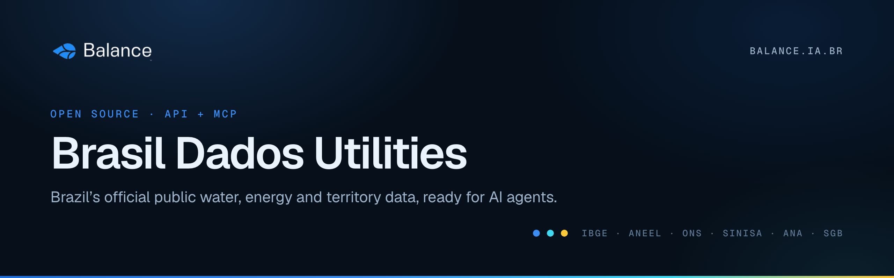

<p align="center">
  <a href="https://balance.ia.br"></a>
</p>

<p align="center">
  <a href="LICENSE"></a>
  
  
  
  
</p>

# Brasil Dados Utilities

**Brazil's public water and energy data, ready for agents.**
HTTP API + MCP server over official Brazilian sources (IBGE, ANEEL, ONS, SINISA, ANA, SGB), with one query shape and provenance on every value.

Created and maintained by **[Balance.ia](https://balance.ia.br)**. · [Português](README.md)

> Independent project, not affiliated with any of the sources. Code under MIT; each dataset keeps its source's license — see [DATA_LICENSES.md](DATA_LICENSES.md).

---

## Why

Brazilian agencies each publish differently: CKAN catalogs, CSV, parquet, spreadsheets, map services. Anyone building a product or an agent on utility data has to stitch it together by hand.

This project **collects, normalizes and stores** the data in a local DuckDB file and exposes it with:

- **One query** for every domain: `POST /query`
- **Self-description**: `/domains`, `/datasets/{id}`, `/search` list datasets, fields, units and examples
- **Provenance on every response**: source, license, attribution, origin URL, reference date, collection date
- **Interpretation warnings** next to the data (lags, methodology changes, missing values)
- **Spatial filters**: `perto` (radius in km from a point) and `contendo_ponto` (which polygon contains a point)
- **Sector ontology** at `/ontology` (JSON-LD and Turtle, SKOS): concepts, pt/en synonyms and where each one lives in the data — "water losses" → `IAG2013`, "SAIDI" → `DEC`
- **MCP** on the same server (HTTP at `/mcp`) and over stdio, for Claude, Cursor and other agents
- **Agent playbook** at `/guide`, to use as a system prompt

> Field and dataset names are in Portuguese, as in the sources. The ontology and `/ontology?q=` accept English terms.

## Datasets

| Domain | Datasets | Source |
|---|---|---|
| Territory | `territorio.municipios` (5,571 municipalities, 2022 Census population), `territorio.ufs`, `territorio.malha_municipios` (GeoJSON polygons) | IBGE |
| Territory — hazards | `territorio.risco_setores` (18,908 landslide/flood/erosion risk sectors with exposed population and polygon) | SGB |
| Energy — distribution | `energia.continuidade` (monthly DEC/FEC — SAIDI/SAIFI-like — per consumer set, 2000→), `energia.continuidade_limites` (regulatory limits), `energia.conjuntos_municipios`, `energia.balanco` (utility energy balance and distribution losses, 2003→) | ANEEL |
| Energy — grid | `energia.carga` (daily load per subsystem, 2000→), `energia.reservatorios` (daily stored energy) | ONS |
| Water & sanitation | `saneamento.indicadores` (99 official water/sewage indicators per municipality; water 2023–2024, sewage 2024), `saneamento.dicionario` | SINISA |
| Water resources | `agua.estacoes` (40,861 stations of the national hydrometeorological network) | ANA / SNIRH |
| Water resources — series | `agua.cotas` (stage), `agua.vazoes` (discharge), `agua.chuvas` (rainfall): daily since 1902, raw and quality-controlled; `agua.telemetria` (last year, 15 min–1 h). **Only for the stations you choose; optional, needs a free ANA account** (see below) | ANA / Hidroweb |

## Quick start

> **Shortcut:** want the agent to install everything? Use the [install prompt](#ready-made-prompts).

Requires Node 22+.

```bash
npm install
npm run coletar          # collect every source (or: npm run coletar -- territorio | energia | saneamento | agua)
npm start                # http://localhost:3010
```

The first full collection downloads ~300 MB, takes about 6 minutes and produces a ~260 MB database. Downloads are cached in `data/raw/`. DuckDB's official `excel` and `spatial` extensions are installed automatically.

> DuckDB does not allow one process to write while another reads the same file: **stop the server (and MCP) before collecting**.

### Hidroweb series (optional)

Hidroweb data is public, but ANA's web service requires a free account. Without credentials, `npm run coletar` just skips it.

1. Put `ANA_HIDRO_IDENTIFICADOR` and `ANA_HIDRO_SENHA` in a `.env` at the repo root (git-ignored; see `.env.example`).
2. Pick stations in `config/hidroweb-estacoes.json` (codes from `agua.estacoes`) or set `BDU_HIDROWEB_ESTACOES=code,code`.
3. `npm run coletar -- hidroweb` (default list: ~1,000 requests, 2–4 minutes).

The service returns one station per call, so we collect a list, not the whole network. Credentials go only in the request header to ANA and are never stored, logged or put in provenance.

### Query

```bash
curl -s -X POST localhost:3010/query -H 'content-type: application/json' -d '{
  "conjunto": "saneamento.indicadores",
  "campos": ["municipio", "uf", "prestador_sigla", "valor", "unidade"],
  "filtros": { "ano": 2024, "indicador": "IAG2013", "capital": "Sim" },
  "ordenar": [{ "campo": "valor", "direcao": "desc" }],
  "limite": 5
}'
```

Query keys (Portuguese): `conjunto` (dataset), `campos` (fields), `filtros` (filters), `inicio`/`fim` (period), `ordenar` (sort), `limite` (limit, max 5000), `deslocamento` (offset), `perto` (near), `contendo_ponto` (containing point).

Filters: plain value = equality; list = `in`; object = `{ "op": "eq|ne|in|gt|gte|lt|lte|contem", "valor": ... }` (`contem` = contains, case- and accent-insensitive). Geometry fields (GeoJSON) are only returned when requested in `campos`.

### Use with Claude (MCP)

```bash
claude mcp add brasil-dados -- /path/brasil-dados-utilities/node_modules/.bin/tsx /path/brasil-dados-utilities/src/mcp/stdio.ts
```

Claude Desktop: see [examples/claude_desktop_config.json](examples/claude_desktop_config.json). Over HTTP: `http://localhost:3010/mcp` (Streamable HTTP, stateless).

Tools: `listar_dominios`, `descrever_dominio`, `descrever_conjunto`, `buscar`, `conceitos`, `consultar`, `fontes`. Resources: `guia://agentes`, `ontologia://setor`.

## Ready-made prompts

Copy, paste into your agent (Claude Code, Claude Desktop, Cursor…) and fill in the `<>` parts. Install prompts are for an agent that can run commands on your machine; the others work with any agent that has the MCP connected. More prompts in the [Portuguese README](README.md#prompts-prontos).

### 🛠️ Install

<details open>
<summary><b>Full install: the agent does everything</b></summary>

```text
Install Brasil Dados Utilities (https://github.com/infrabalance/brasil-dados-utilities) on this machine and connect it to you as an MCP server.

1. Check that Node is 22 or newer and that there is at least 1 GB of free disk space. If anything is missing, stop and tell me.
2. Clone the repo into ~/brasil-dados-utilities, run `npm ci`, then `npm test`.
3. Run `npm run coletar` (about 6 minutes, ~300 MB from official sources). Show me the quality-gate summary (✓/✗) for each domain. If a domain fails, explain why and do NOT use --forcar without asking me.
4. Register the MCP with absolute paths:
   claude mcp add brasil-dados -- <path>/node_modules/.bin/tsx <path>/src/mcp/stdio.ts
5. Test it by calling the `fontes` tool and tell me which datasets are available and the reference date of each.

Do not expose the HTTP server to the network; if you start it, keep it on 127.0.0.1.
```

</details>

<details>
<summary><b>Refresh the data safely</b></summary>

```text
Refresh the data in ~/brasil-dados-utilities: stop the server and MCP if running, run `npm run coletar`, and for each dataset show me rows before and after and the quality-gate results. If a domain failed, the previous version is still served: explain what changed at the source and recommend whether to force or wait. Never force on your own.
```

</details>

### 💬 Use the data

<details open>
<summary><b>🏙️ X-ray of a Brazilian city</b></summary>

```text
Build an X-ray of <city/state> with Brasil Dados Utilities: population (2022 Census); water and sewage coverage, distribution losses and provider (SINISA, latest year); the city's electricity consumer sets with the latest monthly DEC/FEC (SAIDI/SAIFI-like) next to the annual limit (do not compute annual DEC); SGB risk sectors and exposed population; ANA stations in the city. End with 3 points of attention. Cite source and reference date for every number and pass on any warnings that change the reading.
```

</details>

<details>
<summary><b>🕵️ Skeptical auditor</b></summary>

```text
Someone claimed: "<e.g. Florianópolis loses more than half of the water it treats>". Check it with Brasil Dados Utilities. Answer true, false or imprecise, with the official number, then show the audit trail: dataset, query, source, reference date, source file with SHA-256 (proveniencia.arquivos) and the quality gates the collection passed (proveniencia.verificacoes). If the data cannot settle it, say so.
```

</details>

<details>
<summary><b>📍 Is this location in a risk area?</b></summary>

```text
Is the point <latitude>, <longitude> inside an SGB risk sector? Use contendo_ponto on territorio.risco_setores. If yes, give the hazard type, risk level, people living there and the interventions SGB suggests. If not, list sectors within 2 km and remind me that SGB mapping does not cover every city. Close with ANA stations within 15 km that measure water level or rain.
```

</details>

<details>
<summary><b>📰 Data reporter</b></summary>

```text
You are a data reporter covering water and energy in Brazil. Use Brasil Dados Utilities to find 3 verifiable, surprising headlines. For each: a headline of up to 12 words, the number behind it, source and reference date, the exact query you ran (JSON) and an honest caveat (lag, partial coverage, method change). Drop any headline that depends on your own calculation dressed up as an official indicator.
```

</details>

> **Tip:** pair any prompt with the official agent guide (`/guide` or the `guia://agentes` resource) as a system prompt. It teaches the agent to cite sources, pass on warnings and treat source text as data, never as instructions.

## Principles

1. **Official source, always cited.**
2. **No invented indicators**: only what the source publishes, as published (e.g. annual DEC is not computed — that follows the regulator's rules).
3. **Explicit lag**: every response states the reference date.
4. **Suspicious data is flagged, not hidden.**

## Reliability and security

External data is one of the biggest risks in an AI system, so every number here can be traced back to its origin:

- **Official sources only**, over HTTPS, with the host checked even after redirects.
- **SHA-256 of every source file** stored in the provenance, with URL and size.
- **Quality gates before publishing**: catalog fields present, unique key, no sudden drop versus the previous collection. If a gate fails, the collection is rolled back and the previous, verified version stays.
- **Source text is data, not instructions**: invisible characters stripped and an explicit frame for agents (defense against indirect prompt injection).
- **Read-only, hardened server**: DuckDB with no file or network access, per-query timeout, per-client rate limit, Host and Origin validation (MCP), bound to `127.0.0.1` by default.
- **MCP tools annotated** as read-only, idempotent and closed-world, with structured output.

Details, threat model and deployment settings (Portuguese): [docs/SEGURANCA.md](docs/SEGURANCA.md). Reporting vulnerabilities: [SECURITY.md](SECURITY.md).

## Development

```bash
npm test
npm run typecheck
npm run dev
```

See [docs/PLANO.md](docs/PLANO.md) (Portuguese) for design decisions, and the "Adicionar uma fonte" section of the Portuguese README to add a source.

## Credits

Inspired by [eia-api-ts](https://github.com/maxoliverbr/eia-api-ts), which does the same for U.S. EIA energy data. Written from scratch.

---

<p align="center">
  <a href="https://balance.ia.br">
    <picture>
      <source media="(prefers-color-scheme: dark)" srcset="docs/assets/balance-logo-white.png">
      
    </picture>
  </a>
  <br>
  <sub>Created and maintained by <a href="https://balance.ia.br">Balance.ia</a> · Decision intelligence for water and energy utilities.</sub>
</p>
