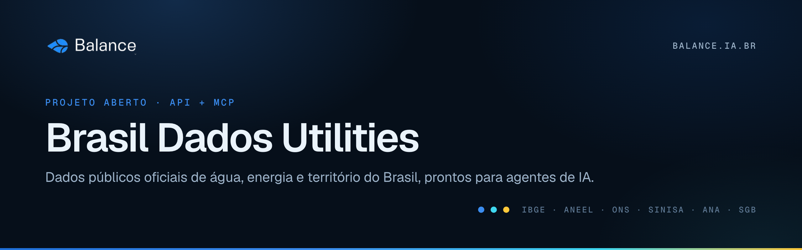

<p align="center">
  <a href="https://balance.ia.br"></a>
</p>

<p align="center">
  <a href="LICENSE"></a>
  
  
  
  
</p>

# Brasil Dados Utilities

**Dados públicos de água e energia do Brasil, prontos para agentes.**
API HTTP + servidor MCP sobre fontes oficiais (IBGE, ANEEL, ONS, SINISA, ANA, SGB), com um formato único de consulta e a proveniência de cada dado.

Criado e mantido por **[Balance.ia](https://balance.ia.br)**. · [English](README.en.md)

> Projeto independente, não afiliado a nenhuma das fontes. Código sob MIT; cada dado mantém a licença da sua fonte — veja [DATA_LICENSES.md](DATA_LICENSES.md).

---

## Por quê

No Brasil, cada órgão publica de um jeito: catálogos CKAN, CSV, parquet, planilhas, serviços de mapa. Quem quer construir um produto ou um agente sobre dados do setor precisa juntar tudo na mão.

Este projeto **coleta, organiza e guarda** os dados num banco local (DuckDB) e expõe tudo com:

- **Uma consulta só** para todos os domínios: `POST /query`
- **Autodescrição**: `/domains`, `/datasets/{id}`, `/search` dizem o que existe, campos, unidades e exemplos
- **Proveniência em toda resposta**: fonte, licença, atribuição, URL de origem, data de referência e data da coleta
- **Avisos de interpretação** junto do dado (defasagem, mudanças de base, valores ausentes)
- **MCP** no mesmo servidor (HTTP em `/mcp`) e por stdio, para Claude, Cursor e outros agentes
- **Filtros espaciais**: `perto` (raio em km a partir de um ponto) e `contendo_ponto` (em qual polígono o ponto cai)
- **Ontologia do setor** em `/ontology` (JSON-LD e Turtle, SKOS): conceitos, sinônimos pt/en e onde cada um está nos dados — "perdas de água" → `IAG2013`, "SAIDI" → `DEC`
- **Guia para agentes** em `/guide`, para usar como instrução de sistema

## Domínios

| Domínio | Conjuntos | Fonte | Status |
|---|---|---|---|
| Território | `territorio.municipios`, `territorio.ufs`, `territorio.malha_municipios` (polígonos GeoJSON) | IBGE | ✅ disponível |
| Energia — distribuição | `energia.continuidade` (DEC/FEC mensal por conjunto, 2000→), `energia.continuidade_limites`, `energia.conjuntos_municipios`, `energia.balanco` (balanço e perdas, 2003→) | ANEEL | ✅ disponível |
| Energia — sistema | `energia.carga` (diária por subsistema, 2000→), `energia.reservatorios` (EAR diária) | ONS | ✅ disponível |
| Saneamento | `saneamento.indicadores` (99 indicadores de água e esgoto por município; água 2023–2024, esgoto 2024), `saneamento.dicionario` | SINISA | ✅ disponível |
| Recursos hídricos | `agua.estacoes` (40 mil estações da Rede Hidrometeorológica Nacional) | ANA / SNIRH | ✅ disponível |
| Recursos hídricos — séries | `agua.cotas`, `agua.vazoes`, `agua.chuvas` (séries diárias desde 1902, brutas e consistidas) e `agua.telemetria` (último ano, 15 min a 1 h), **das estações que você escolher** | ANA / Hidroweb | ✅ opcional — exige cadastro gratuito na ANA ([ver abaixo](#séries-do-hidroweb-opcional)) |
| Território — risco | `territorio.risco_setores` (18.908 setores de risco: deslizamento, inundação…, com pessoas expostas e polígono) | SGB | ✅ disponível |

## Começar

> **Atalho:** prefere que o agente instale tudo? Use o [prompt de instalação](#prompts-prontos).

Requer Node 22+.

```bash
npm install
npm run coletar          # baixa todas as fontes (ou: npm run coletar -- territorio | energia | saneamento | agua)
npm start                # http://localhost:3010
```

A primeira coleta completa baixa ~300 MB (a maior parte é a ANEEL), leva uns 6 minutos e gera um banco de ~260 MB; os arquivos ficam em cache em `data/raw/`, e as próximas coletas só baixam o que mudou nas últimas 20 h (anos fechados do ONS nunca são baixados de novo).

A leitura das planilhas do SINISA e os cruzamentos espaciais usam as extensões oficiais `excel` e `spatial` do DuckDB, baixadas automaticamente na primeira coleta.

> O DuckDB não deixa um processo escrever enquanto outro lê o mesmo arquivo: **pare o servidor (e o MCP) antes de coletar** e suba de novo depois.

### Séries do Hidroweb (opcional)

O dado do Hidroweb é público, mas o serviço da ANA exige cadastro (gratuito). Sem credencial, `npm run coletar` simplesmente pula essa parte.

1. Peça acesso ao serviço Hidroweb na ANA e crie um `.env` na raiz (já está no `.gitignore`), como em [`.env.example`](.env.example):
   ```
   ANA_HIDRO_IDENTIFICADOR=seu_usuario
   ANA_HIDRO_SENHA=sua_senha
   ```
2. Escolha as estações em [`config/hidroweb-estacoes.json`](config/hidroweb-estacoes.json) (códigos em `agua.estacoes`) ou com `BDU_HIDROWEB_ESTACOES=cod,cod` no `.env`. A lista que vem no repositório tem Manaus, Boa Vista, Marabá, Juazeiro, Blumenau, Guaíba (Cais Mauá) e dois pluviômetros.
3. `npm run coletar -- hidroweb`. Com as 8 estações padrão, são cerca de mil requisições e 2 a 4 minutos.

O serviço só entrega uma estação por chamada (até um ano por vez nas séries e 30 dias na telemetria), por isso a coleta é por lista e não da rede inteira. A credencial vai só no cabeçalho para a ANA e nunca entra no banco, em log ou na proveniência. Telemetria: últimos 365 dias (`BDU_HIDROWEB_TELEMETRIA_DIAS`).

### Consultar

```bash
curl -s -X POST localhost:3010/query -H 'content-type: application/json' -d '{
  "conjunto": "territorio.municipios",
  "campos": ["codigo_ibge", "nome", "populacao_2022"],
  "filtros": { "uf": "SC", "populacao_2022": { "op": "gte", "valor": 100000 } },
  "ordenar": [{ "campo": "populacao_2022", "direcao": "desc" }],
  "limite": 5
}'
```

Resposta (resumida):

```json
{
  "conjunto": "territorio.municipios",
  "dados": [{ "codigo_ibge": "4209102", "nome": "Joinville", "populacao_2022": 616317 }, "..."],
  "total": 14,
  "proveniencia": {
    "fonte": "IBGE — Instituto Brasileiro de Geografia e Estatística",
    "licenca": "Dados públicos (Lei 12.527/2011 e Decreto 8.777/2016)",
    "atribuicao": "Fonte: IBGE",
    "data_referencia": "Censo 2022 (população); divisão territorial vigente na coleta",
    "coletado_em": "2026-11-15T18:32:26.355Z"
  },
  "avisos": ["População = Censo Demográfico 2022 (população residente), não estimativa anual.", "..."]
}
```

Campos de geometria (GeoJSON) só vêm quando pedidos em `campos`, por exemplo `"campos": ["setor", "geometria"]`.

Filtros espaciais:

```jsonc
// estações telemétricas a até 25 km de Blumenau (acrescenta distancia_km e ordena por ela)
{ "conjunto": "agua.estacoes", "filtros": { "telemetrica": true }, "perto": { "latitude": -26.92, "longitude": -49.07, "raio_km": 25 } }

// este ponto está em algum setor de risco?
{ "conjunto": "territorio.risco_setores", "contendo_ponto": { "latitude": -22.2522, "longitude": -42.5209 } }
```

Filtros: valor direto = igualdade; lista = `in`; objeto = `{ "op": "eq|ne|in|gt|gte|lt|lte|contem", "valor": ... }`. `contem` ignora maiúsculas e acentos. Limite padrão 100, máximo 5000; pagine com `deslocamento`.

Mais exemplos: [curl](examples/consultas.sh) · [cliente TypeScript](examples/cliente.ts) · [perguntas para testar com um agente](examples/perguntas-para-agentes.md). Cada conjunto também traz exemplos em `/datasets/{id}`.

### Usar com Claude (MCP)

**Claude Code:**

```bash
claude mcp add brasil-dados -- /caminho/brasil-dados-utilities/node_modules/.bin/tsx /caminho/brasil-dados-utilities/src/mcp/stdio.ts
```

**Claude Desktop:** veja [examples/claude_desktop_config.json](examples/claude_desktop_config.json).

**Por HTTP:** com o servidor no ar, o endpoint MCP (Streamable HTTP, sem sessão) é `http://localhost:3010/mcp`.

Ferramentas: `listar_dominios`, `descrever_dominio`, `descrever_conjunto`, `buscar`, `conceitos`, `consultar`, `fontes`. Resources: `guia://agentes`, `ontologia://setor`.

## Prompts prontos

Copie, cole no seu agente (Claude Code, Claude Desktop, Cursor…) e ajuste o que está entre `<>`. Os prompts de instalação servem para um agente que roda comandos no seu computador. Os de consumo servem para qualquer agente com o MCP conectado.

### 🛠️ Para instalar

<details open>
<summary><b>Instalação completa: o agente faz tudo</b></summary>

```text
Instale o Brasil Dados Utilities (https://github.com/infrabalance/brasil-dados-utilities) nesta máquina e conecte-o a você como servidor MCP.

1. Confira se o Node é 22 ou mais novo e se há pelo menos 1 GB livre em disco. Se faltar algo, pare e me diga.
2. Clone o repositório em ~/brasil-dados-utilities, rode `npm ci` e depois `npm test`.
3. Rode `npm run coletar`. Leva uns 6 minutos e baixa ~300 MB de fontes oficiais. Me mostre o resumo dos portões de qualidade (✓/✗) de cada domínio. Se algum domínio for reprovado, explique o motivo e NÃO use --forcar sem me perguntar.
4. Registre o MCP com caminhos absolutos:
   claude mcp add brasil-dados -- <caminho>/node_modules/.bin/tsx <caminho>/src/mcp/stdio.ts
5. Teste chamando a ferramenta `fontes` e me diga quais conjuntos estão disponíveis e a data de referência de cada um.

Não exponha o servidor HTTP na rede; se subir, deixe em 127.0.0.1.
```

</details>

<details>
<summary><b>Instalação leve: só um domínio</b></summary>

```text
Instale o Brasil Dados Utilities (https://github.com/infrabalance/brasil-dados-utilities) em ~/brasil-dados-utilities com `npm ci`, mas colete só o necessário: primeiro `npm run coletar -- territorio` (os outros domínios cruzam com os municípios e a malha do IBGE) e depois `npm run coletar -- <energia | saneamento | agua>`. Depois registre o MCP com `claude mcp add` usando caminhos absolutos e me mostre o que ficou disponível com a ferramenta `listar_dominios`.
```

</details>

<details>
<summary><b>Atualizar os dados com segurança</b></summary>

```text
Atualize os dados do Brasil Dados Utilities em ~/brasil-dados-utilities:
1. Pare o servidor e o MCP se estiverem rodando (o DuckDB não deixa ler e escrever ao mesmo tempo).
2. Rode `npm run coletar`.
3. Para cada conjunto, me mostre as linhas antes e depois e o resultado dos portões de qualidade.
4. Se algum domínio foi reprovado, a versão anterior continua valendo: me explique o que mudou na fonte e recomende se devo forçar ou esperar. Não force sozinho.
```

</details>

<details>
<summary><b>Subir a API e montar um painel</b></summary>

```text
Suba o servidor do Brasil Dados Utilities (`npm start`, em 127.0.0.1:3010) e crie um arquivo painel.html, sem framework, que consulte POST /query e mostre:
- um gráfico de linha da energia armazenada (energia.reservatorios) por subsistema nos últimos 2 anos;
- uma tabela das 10 capitais com maior perda de água na distribuição (saneamento.indicadores, IAG2013, ano 2024).
Embaixo de cada gráfico, mostre fonte, licença e data de referência a partir do campo `proveniencia` da resposta.
```

</details>

### 💬 Para consumir os dados

<details open>
<summary><b>🏙️ Raio-x do meu município</b></summary>

```text
Monte um raio-x de <município/UF> com o Brasil Dados Utilities:
- população (Censo 2022);
- água e esgoto: atendimento, perdas na distribuição e prestador (SINISA, ano mais recente);
- energia: conjuntos elétricos do município e o DEC/FEC mensal mais recente de cada um, ao lado do limite anual (não calcule DEC anual);
- risco: setores do SGB, pessoas expostas e tipologia;
- estações hidrometeorológicas da ANA no município.
Termine com 3 pontos de atenção. Cite fonte e data de referência de cada número e repasse os avisos que mudem a leitura.
```

</details>

<details>
<summary><b>📰 Repórter de dados: três manchetes com dado oficial</b></summary>

```text
Você é um repórter de dados do setor de água e energia. Use o Brasil Dados Utilities para encontrar 3 manchetes verificáveis e surpreendentes. Para cada uma: título com até 12 palavras, o número que sustenta a manchete, a fonte com data de referência, a consulta exata que você usou (JSON) e uma ressalva honesta (defasagem, cobertura parcial, mudança de método). Descarte qualquer manchete que dependa de conta sua que pareça indicador oficial.
```

</details>

<details>
<summary><b>🕵️ Auditor cético: checar uma afirmação</b></summary>

```text
Alguém disse: "<ex.: Florianópolis perde mais da metade da água que trata>". Verifique com o Brasil Dados Utilities.
Responda: verdadeiro, falso ou impreciso, com o número oficial. Depois mostre a trilha de auditoria: conjunto, consulta, fonte, data de referência, arquivo de origem com SHA-256 (proveniencia.arquivos) e os portões de qualidade que a coleta passou (proveniencia.verificacoes). Se o dado não permitir concluir, diga isso.
```

</details>

<details>
<summary><b>📍 Este endereço está em área de risco?</b></summary>

```text
O ponto <latitude>, <longitude> está dentro de algum setor de risco do SGB? Use contendo_ponto em territorio.risco_setores. Se estiver, diga a tipologia, o grau de risco, quantas pessoas vivem no setor e quais intervenções o SGB sugere. Se não estiver, liste os setores a até 2 km (use o centroide) e lembre que o mapeamento do SGB não cobre todos os municípios. Feche com as estações da ANA a até 15 km que medem nível ou chuva.
```

</details>

<details>
<summary><b>🌊 Plantão hídrico e elétrico</b></summary>

```text
Faça um boletim de uma página sobre o sistema elétrico hoje: energia armazenada nos reservatórios por subsistema (último dia disponível), comparada ao mesmo dia de 1 e 2 anos atrás, e a carga média dos últimos 30 dias contra o mesmo período do ano anterior. Use semáforo (🟢🟡🔴) só com critério explícito que você define e declara. Cite a data de referência do ONS.
```

</details>

<details>
<summary><b>⚡ Distribuidora sob a lupa</b></summary>

```text
Analise a distribuidora <nome ou CNPJ> com o Brasil Dados Utilities. Junte os conjuntos pelo CNPJ (as siglas mudam entre bases).
1. Os 10 conjuntos com DEC mensal mais alto nos últimos 12 meses publicados, ao lado do limite anual de cada um.
2. A evolução das perdas totais no balanço de energia ano a ano.
3. O que os dados NÃO dizem (ex.: a ANEEL não abre perda técnica e não técnica).
Não calcule DEC/FEC anual: mostre os valores mensais publicados e deixe claro que a apuração anual segue o PRODIST.
```

</details>

<details>
<summary><b>🏛️ Briefing para prefeito ou Defesa Civil</b></summary>

```text
Prepare um briefing de 5 tópicos para o prefeito de <município> antes do período de chuvas: setores de risco muito alto (pessoas, domicílios, tipologia), estações telemétricas que podem servir de alerta, cobertura de água e esgoto e a continuidade de energia dos conjuntos que atendem a cidade. Linguagem simples, sem jargão; cada número com fonte entre parênteses.
```

</details>

<details>
<summary><b>🎓 Professor do setor</b></summary>

```text
Use a ferramenta `conceitos` do Brasil Dados Utilities para me explicar, como se eu estivesse começando no setor, o que são DEC, FEC, perdas de água na distribuição e energia armazenada. Para cada conceito: definição curta, equivalente em inglês, onde o dado está (conjunto e campo) e um exemplo real consultado agora, com fonte.
```

</details>

<details>
<summary><b>🗺️ Ranking nacional em um prompt</b></summary>

```text
Faça um ranking das 27 capitais combinando três dados oficiais: perda de água na distribuição (IAG2013, 2024), atendimento de esgoto (IES0001, 2024) e pessoas em setores de risco do SGB. Mostre cada indicador separado numa tabela e NÃO invente um índice composto sem me perguntar; se eu pedir um, explique os pesos e deixe claro que é uma conta sua, não um indicador oficial.
```

</details>

> **Dica:** combine qualquer prompt acima com o guia oficial para agentes (`/guide` ou o resource `guia://agentes`) como prompt de sistema. Ele ensina o agente a citar fonte, repassar avisos e tratar texto da fonte como dado, nunca como instrução.

## Rotas

| Rota | O quê |
|---|---|
| `GET /` | Sobre o projeto e links |
| `GET /domains` · `/domains/{id}` | Domínios e conjuntos, com status da coleta |
| `GET /datasets/{id}` | Campos, unidades, avisos, exemplos e proveniência |
| `GET /search?q=` | Busca conjuntos por conceito |
| `POST /query` | Consulta |
| `GET /sources` | Fontes, licenças e coletas |
| `GET /ontology` | Ontologia (JSON-LD; `?formato=turtle`; `?q=termo` acha conceitos e onde estão) |
| `GET /guide` | Guia para agentes (markdown) |
| `GET /openapi` | OpenAPI 3.1 |
| `/mcp` | MCP |

## Princípios

1. **Fonte oficial, sempre citada.**
2. **Não inventa indicador**: só o que a fonte publica, como ela publica.
3. **Defasagem explícita**: toda resposta diz a data de referência.
4. **Dado suspeito é marcado, não escondido.**

## Confiabilidade e segurança

Dado externo é um dos maiores riscos de um sistema de IA. Por isso cada número aqui pode ser auditado até a origem:

- **Só fontes oficiais**, por HTTPS, com o host conferido inclusive após redirecionamento.
- **SHA-256 de cada arquivo de origem** gravado na proveniência, com URL e tamanho.
- **Portões de qualidade antes de publicar**: campos do catálogo presentes, chave única, sem queda brusca em relação à coleta anterior. Se algo falha, a coleta é desfeita e fica a versão anterior, já conferida.
- **Texto da fonte é dado, não instrução**: caracteres invisíveis removidos e moldura explícita para agentes (defesa contra injeção indireta de prompt).
- **Servidor só leitura e blindado**: DuckDB sem acesso a arquivo ou rede, tempo limite por consulta, limite por cliente, validação de Host e Origin (MCP), ouvindo só em `127.0.0.1` por padrão.
- **Ferramentas MCP anotadas** como só leitura, idempotentes e sem efeito no mundo, com resposta estruturada.

Detalhes, riscos e configuração para publicar: [docs/SEGURANCA.md](docs/SEGURANCA.md). Relato de vulnerabilidade: [SECURITY.md](SECURITY.md).

## Desenvolvimento

```bash
npm test          # testes
npm run typecheck
npm run dev       # servidor com recarga
```

Estrutura: `src/dominios` (catálogo), `src/coletores` (um por fonte), `src/consulta` (validação e SQL), `src/api` (HTTP), `src/mcp` (MCP), `src/ontologia`. Plano e decisões em [docs/PLANO.md](docs/PLANO.md).

### Adicionar uma fonte

1. **Coletor** em `src/coletores/<fonte>.ts` implementando `Coletor` (`dominio`, `conjuntos`, `coletar`): baixa com `baixarArquivo` (cache), grava a tabela e chama `registrarProveniencia` com o que foi tratado (repetições removidas, valores descartados…).
2. **Conjunto** no domínio em `src/dominios/` — campos com descrição e unidade, `campoTempo`, `chave`, `tags`, `avisos` e pelo menos um exemplo. Os testes validam todo exemplo contra o catálogo.
3. **Fonte** em `src/dominios/fontes.ts` com licença e atribuição, e uma linha em [DATA_LICENSES.md](DATA_LICENSES.md).
4. Registre o coletor em `src/coletores/cli.ts` e, se fizer sentido, o conceito em `src/ontologia/ontologia.ts`.

Regra de ouro: **publicar como a fonte publica**. Tratamento só o necessário para consultar (formato, tipos, repetições), sempre registrado na proveniência.

## Créditos

Inspirado no [eia-api-ts](https://github.com/maxoliverbr/eia-api-ts), que faz o mesmo para os dados de energia dos EUA (EIA). Código escrito do zero.

---

<p align="center">
  <a href="https://balance.ia.br">
    <picture>
      <source media="(prefers-color-scheme: dark)" srcset="docs/assets/balance-logo-white.png">
      
    </picture>
  </a>
  <br>
  <sub>Criado e mantido por <a href="https://balance.ia.br">Balance.ia</a> · Inteligência de decisão para utilities de água e energia.</sub>
</p>
